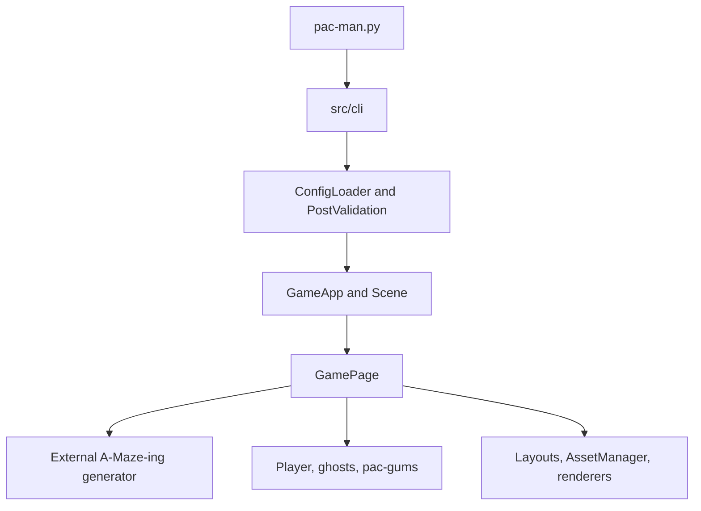

*This project has been created as part of the 42 curriculum by fedegugl, gcerrete*

# PAC-MAN

- [Description](#description)
- [Instructions](#instructions)
- [Graphics and UI](#graphics-and-ui)
- [Resources](#resources)
- [Configuration](#configuration)
- [Highscore](#highscore)
- [Maze Generation](#maze-generation)
- [Implementation](#implementation)
- [General Software Architecture](#general-software-architecture)
- [Project Management](#project-management)

## Description

This project is a configurable, keyboard-controlled Pac-Man game built with
Python and Pygame for the 42 curriculum. It combines tile-based movement,
pellet collection, ghost states, score and life tracking, ten configurable
levels, and a responsive graphical interface. Mazes are supplied by the
assigned external A-Maze-ing package.

## Instructions

### Requirements

- Python 3.10 or later
- [uv](https://docs.astral.sh/uv/) and GNU Make
- Pygame 2.6.1 or later and NumPy 1.26 or later (installed by `uv`)

From the repository root, install the project dependencies and assigned maze
generator package, then run the game:

```bash
make install
make run
```

`make run` launches `pac-man.py` with `config.json`. The CLI also accepts one
configuration path directly after dependencies have been installed:

```bash
python3 pac-man.py config.json
```

Useful development targets:

```bash
make debug   # Run through Python's debugger
make lint    # Run flake8 and the required mypy checks
make clean   # Remove Python and type-checker caches
python3 -m unittest discover -s tests -v  # Run unit tests
```

### Controls

- In the main and pause menus, use Up/Down and Enter to navigate and select.
- During play, use the arrow keys or WASD to move; Esc opens the pause menu.
- In the name-entry screen, type up to 10 letters, digits, or spaces; use
  Backspace to edit, Enter to save, or Esc to leave without saving.
- The settings screen includes a fullscreen toggle.

## Graphics and UI

The game uses PNG artwork for Pac-Man, the four ghosts, pellets, maze walls,
intersections, borders, and the 42 logo. The title, HUD, menus, and score
panels use a custom bitmap font assembled from PNG glyphs rather than a TTF
font renderer.

The play screen has score and lives panels around a centered maze. Its layout
recomputes tile size when the window or level dimensions change; the window
cannot be reduced below 80% of the detected desktop resolution. Sprite
resizing uses nearest-neighbor sampling on RGBA pixel buffers, with cached
fitted panel artwork to avoid repeating image work every frame. See
[`assets/mlx_compliance.md`](assets/mlx_compliance.md) for the documented
Pygame-to-MLX-equivalent operations and their constraints.

## Resources

### References

- [Pac-Man Dossier](https://www.dossier.net/games/pacmanflash/)
- [Pac-Man Ghost AI Explained](https://www.youtube.com/watch?v=ataGotQ7ir8),
  Retro Game Mechanics Explained
- [How Frightened Ghosts Decide Where to Go](https://www.youtube.com/watch?v=eFP0_rkjwlY),
  Retro Game Mechanics Explained
- [Pygame documentation](https://www.pygame.org/docs/)
- [Project subject](assets/subject.md)

### Use of AI

AI assistants, including Claude and GitHub Copilot, were used to support code
review, edge-case analysis, documentation, and project-planning materials.
Suggestions were reviewed and tested by the team before being retained.

## Configuration

The game reads a JSON configuration file. Full-line comments beginning with
`#` are removed before parsing. Invalid values fall back to safe defaults with
warnings; unknown keys are ignored. The repository's runnable ten-level
example is [`config.json`](config.json).

| Key | Default | Constraints and meaning |
| :--- | :--- | :--- |
| `lives` | `3` | Integer from 1 to 99. |
| `seed` | `42` | Integer from 0 to 4,294,967,295; passed to the maze generator. |
| `pacgum_coverage` | `100` | Integer from 1 to 100; percentage of eligible walkable cells containing a pellet. At 100, every eligible cell gets one; Pac-Man's starting cell is intentionally empty. Four corner cells are super-pacgums, and the actual count is derived from each generated maze. |
| `points_per_pacgum` | `10` | Integer from 0 to 100,000. |
| `points_per_super_pacgum` | `50` | Integer from 0 to 100,000. |
| `points_per_ghost` | `200` | Integer from 0 to 100,000. |
| `level_max_time` | `90` | Integer from 1 to 3600 seconds. |
| `highscore_filename` | `highscores.json` | A non-empty string; `.json` is appended if needed. Existing `highscore.txt` records are loaded as a fallback if the configured file is absent. |
| `levels` | One 21 x 21 level in the parser fallback | A runnable configuration must contain at least 10 levels. Each level has `width` and `height`; each dimension defaults to 21, must be at least 5 for play, and should be odd. |

The checked-in configuration uses 10 levels, three lives, seed 42, and a
155-second level timer. This meets the validator's recommended minimum for the
largest configured maze. Missing or invalid numeric settings use the defaults
above. Even maze dimensions produce a warning because maze generators usually
work best with odd dimensions.

## Highscore

Scores are loaded at startup into an in-memory list, validated, sorted in
descending order, and limited to the top 10. Records contain a player name and
a non-negative integer score. Names accept ASCII letters, digits, and spaces,
up to 10 characters. The main menu links to a dedicated high-score screen.

Scores are stored as JSON at the configured `highscore_filename`. If that file
does not exist but the legacy `highscore.txt` file does, its records are loaded
and carried forward when the next score is saved. Missing or malformed files do
not prevent the game from starting, and invalid records are skipped.

## Maze Generation

Maze generation is delegated to the assigned `mazegenerator` package, which is
installed by `make install` from the dependency under `packaging/`. The project
does not implement or modify the generator. The first level uses the configured
seed; each later level receives a fresh random seed. For every level, the
adapter passes its configured width and height with `perfect=False`, then
checks that the returned grid matches the requested dimensions. Generator
failures are reported as a handled game-start error.

The package returns a grid of wall bitmasks. The UI uses those masks to draw
walls and intersections; `MazeRenderer` keeps this rendering separate from
player and ghost logic.

## Implementation

### Gameplay

- Pac-Man moves through walkable cells in four directions. Movement is
  interpolated between cell centers for rendering.
- Pac-gums award configured points. Super-pac-gums award points and make
  ghosts frightened for a limited time.
- Ghosts use maze pathfinding to chase Pac-Man, flee while frightened, and
  return to their corner after being eaten.
- Completing a level advances to the next configured maze; losing all lives or
  running out of time ends the game.

### Rendering

The UI is divided into scenes for the main menu, gameplay, pause/settings,
instructions, high scores, game over, and victory. Layout classes calculate
screen and panel geometry; asset managers load image and bitmap-font resources;
renderers draw the maze, entities, and HUD. Resizing updates layout and the
size-specific assets without changing the game rules.

## General Software Architecture

The code is organized into three main areas:

- `src/cli/` validates command-line input and reports configuration errors.
- `src/core/` parses and validates configuration, and owns player, ghost,
  pellet, and timer logic.
- `src/ui/` owns the Pygame application loop, scenes, layout, asset managers,
  panels, and rendering.

The runtime flow is:



## Project Management

The team used a project plan, a Kanban backlog, progress tracking, and an
acceptance-test checklist. UI work was primarily handled by `fedegugl`, core
gameplay by `gcerrete`, with CLI, parsing, and reviews shared.

- [Project management overview](assets/Kanban%20Backlog/README.md)
- [Project plan](assets/Kanban%20Backlog/project_plan.md)
- [Progress tracking and decision log](assets/Kanban%20Backlog/Progress_tracking.md)
